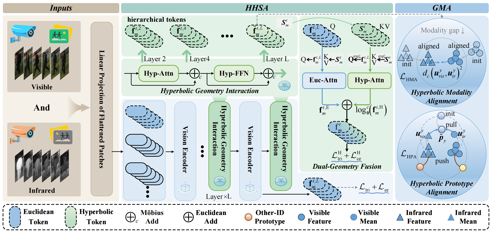

# Hyperbolic Hierarchical Alignment for Video-Based Visible-Infrared Person Re-Identification

This repository provides the official implementation of **HHA: Hyperbolic Hierarchical Alignment for Video-Based Visible-Infrared Person Re-Identification**.



---

## Getting Started

### Data Preparation

We provide training and evaluation code for **HITSZ-VCM** and **BUPTCampus**. Download and prepare each dataset following the instructions in its repository:

- [HITSZ-VCM](https://github.com/VCM-project233/MITML)
- [BUPTCampus](https://github.com/dyhBUPT/BUPTCampus)

In the commands below, replace `/path/to/HITSZ-VCM` and `/path/to/BUPTCampus` with the corresponding dataset root directories. Run all commands from the repository root.

### Training

Train HHA on **HITSZ-VCM**:

```bash
python main.py \
  --mode train --dataset vcm \
  --vcm_data_path /path/to/HITSZ-VCM \
  --output_path logs/vcm
```

Train HHA on **BUPTCampus**:

```bash
python main.py \
  --mode train --dataset bupt \
  --bupt_data_path /path/to/BUPTCampus \
  --output_path logs/bupt
```

### Pretrained Models

Pretrained HHA checkpoints for both datasets are available on [Google Drive](https://drive.google.com/drive/folders/16mCYjIoNLY0jc5RDYtIM3OPXaCrl8-FG?usp=sharing). Both models use a sequence length of 6 frames.

| Dataset | Checkpoint | Sequence Length |
| --- | --- | --- |
| HITSZ-VCM | `HHA_VCM.pth` | 6 |
| BUPTCampus | `HHA_BUPT.pth` | 6 |

Rename each downloaded checkpoint to `best_model.pth` and place it in the corresponding directory:

```text
checkpoints/
├── vcm/
│   └── best_model.pth    # HHA_VCM.pth
└── bupt/
    └── best_model.pth    # HHA_BUPT.pth
```

Set `--resume_test_path` to the directory containing `best_model.pth`.

### Evaluation

Evaluate the pretrained model on **HITSZ-VCM**:

```bash
python main.py \
  --mode test --dataset vcm \
  --vcm_data_path /path/to/HITSZ-VCM \
  --resume_test_path checkpoints/vcm \
  --output_path logs/vcm_test
```

Evaluate the pretrained model on **BUPTCampus**:

```bash
python main.py \
  --mode test --dataset bupt \
  --bupt_data_path /path/to/BUPTCampus \
  --resume_test_path checkpoints/bupt \
  --output_path logs/bupt_test
```

Evaluation reports Rank-1, Rank-5, Rank-10, Rank-20, and mAP for both infrared-to-visible and visible-to-infrared retrieval.

## Citation

If you find this work useful in your research, please cite our HHA paper and the related VLD work:

```bibtex
@inproceedings{li2026hha,
  title={Hyperbolic Hierarchical Alignment for Video-Based Visible-Infrared Person Re-Identification},
  author={Li, Shuang and Kuang, Changjiang and Leng, Jiaxu and Tan, Mingpi and Wu, Zhanjie and Yan, Shuanglin and Gao, Xinbo},
  booktitle={International Conference on Machine Learning},
  year={2026}
}

@article{li2025video,
  title={Video-Level Language-Driven Video-Based Visible-Infrared Person Re-Identification},
  author={Li, Shuang and Leng, Jiaxu and Kuang, Changjiang and Tan, Mingpi and Gao, Xinbo},
  journal={IEEE Transactions on Information Forensics and Security},
  year={2025},
  publisher={IEEE}
}
```
